# 📊 Monitoreo de Caudales SCM

Visualización de caudales reportados por la Sociedad de Canal del Maipo.

> *Los gráficos se actualizan automáticamente cada 2 horas.*

---

## BT CANAL EL CARMEN

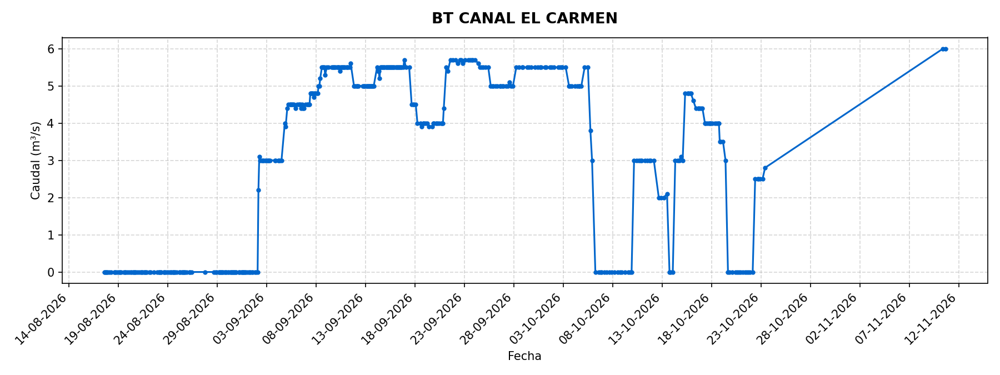

---

## BT CANAL LA PUNTA

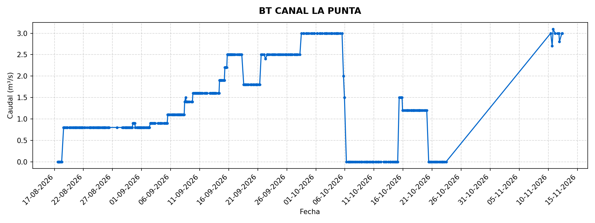

---

## BT CANAL SAN CARLOS REGANTES

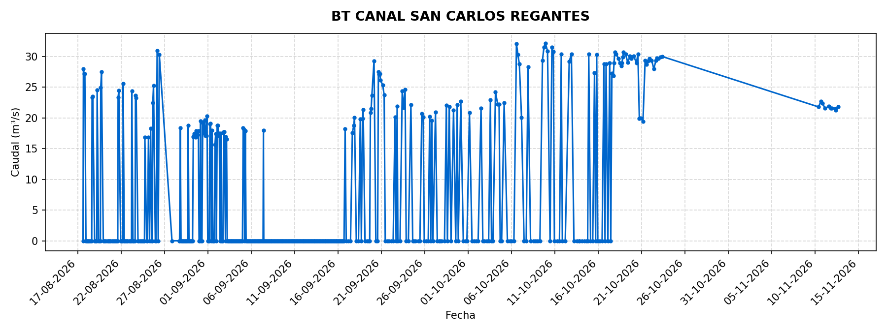

---

## CANAL BATUCO

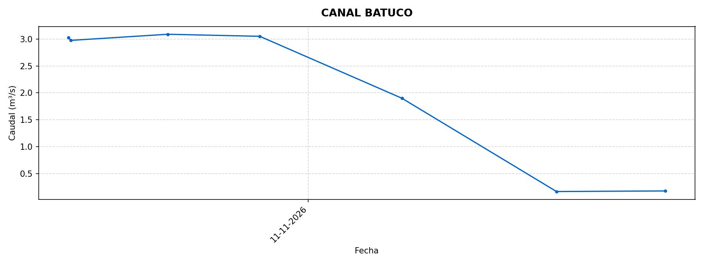

---

## CANAL COLINA

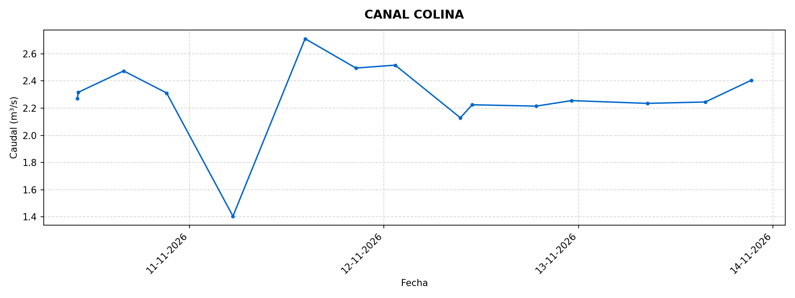

---

## CANAL EYZAGUIRRE

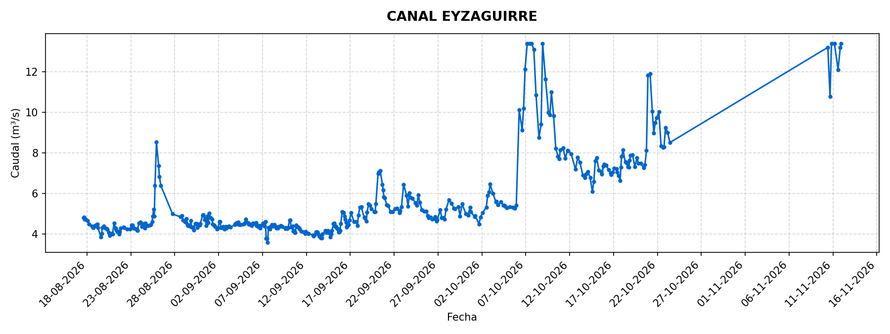

---

## CANAL FLORIDA

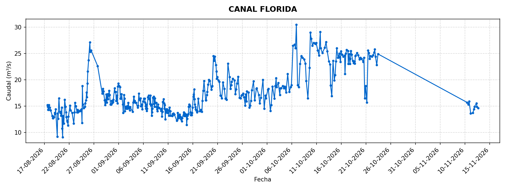

---

## CANAL LA PÓLVORA

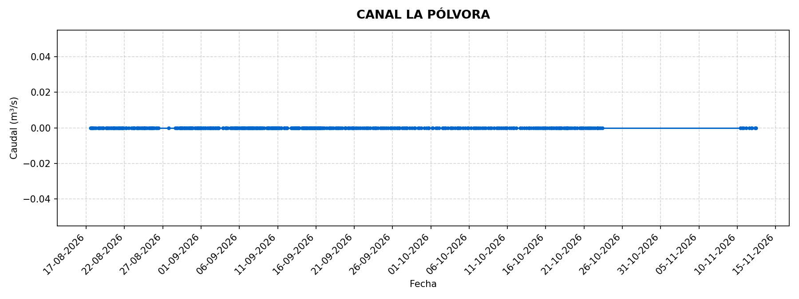

---

## CANAL LAS PERDICES

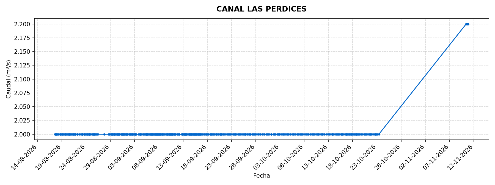

---

## CANAL LO CASTRO

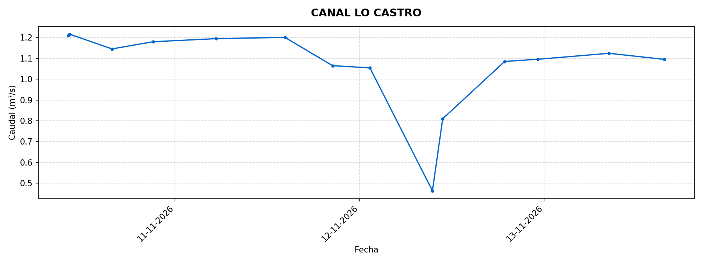

---

## CANAL LO SOLAR

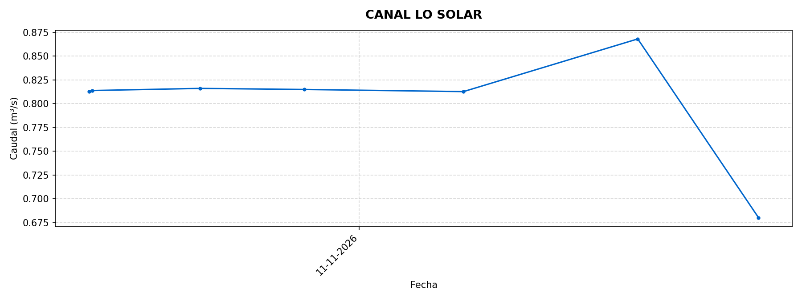

---

## CANAL SAN FRANCISCO

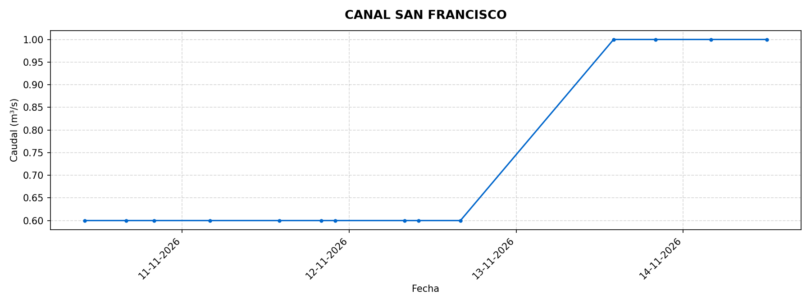

---

## PTAP CHAMISERO

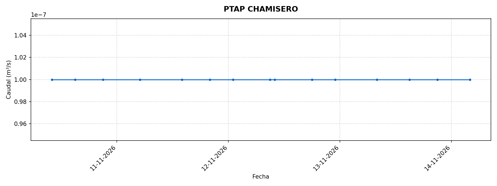

---

## REGADOR SCM

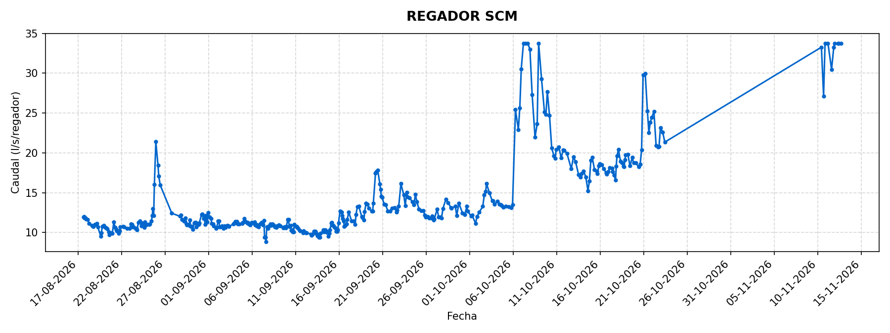

---

## RÍO MAIPO

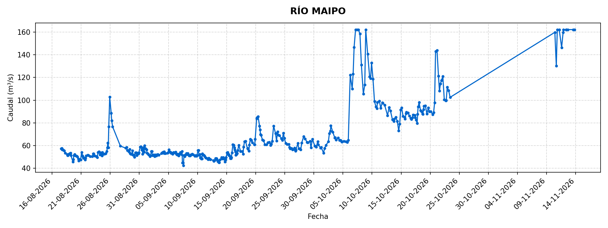

---

